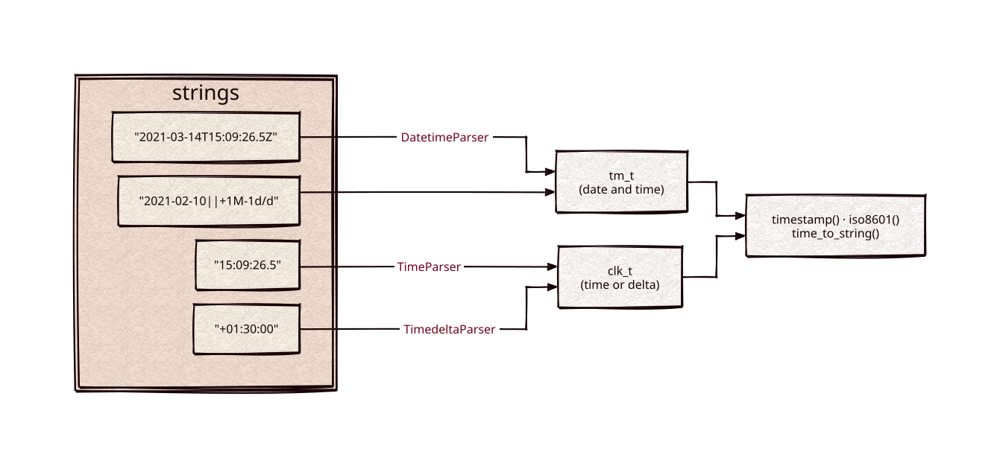

# datetime

[](https://github.com/Kronuz/datetime/actions/workflows/ci.yml)
[](LICENSE)


Date and time parsing for C++20: ISO 8601 timestamps, Elasticsearch-style date
math (`2021-01-01||+1M-1d/d`), times of day, and durations, with ISO 8601
formatting back out. For query languages and APIs that take dates as text.



## ✨ Highlights

- **ISO 8601**, date-only through fractional seconds, with `Z` or `±HH:MM`
  offsets.
- **Date math** after `||`: add and subtract `y M w d h m s`, round up to the end
  of a unit with `/M`, or down to its start with `//M`, leap years included.
- **Times and durations**: `"15:09:26.5"` and `"+01:30:00"`, to and from seconds.
- **Clear errors**: `DatetimeError` and its subclasses, all `std::runtime_error`.
- **Predicates**: `isDate`, `isDatetime`, `isTime`, `isTimedelta`.

## 📦 Installation

Requires a C++20 compiler and CMake 3.14 or newer; it fetches
[strict-stox](https://github.com/Kronuz/strict-stox) and compiles one source file.
CI builds it on Linux (x86_64, arm64), macOS (arm64, x86_64), and FreeBSD, plus
ASan, UBSan, and TSan builds.

```cmake
include(FetchContent)
FetchContent_Declare(datetime
  GIT_REPOSITORY https://github.com/Kronuz/datetime.git
  GIT_TAG        main)
FetchContent_MakeAvailable(datetime)

target_link_libraries(my_app PRIVATE datetime::datetime)
```

## 🚀 Quick start

```cpp
#include "datetime.h"

#include <cstdio>

int main() {
	auto tm = Datetime::DatetimeParser(std::string_view("2021-03-14T15:09:26.5Z"));
	std::printf("%f\n", Datetime::timestamp(tm));                   // Unix seconds
	std::puts(Datetime::iso8601(tm).c_str());                       // 2021-03-14T15:09:26.5Z

	auto end_of_feb = Datetime::DatetimeParser(std::string_view("2020-02-10||/M"));   // 2020-02-29, end of day
	std::puts(Datetime::iso8601(end_of_feb).c_str());
}
```

[`examples/demo.cc`](examples/demo.cc) walks every input form and the rounding
rules.

## 🎯 When to use it

- ✅ Parsing dates from users or query strings, with relative date math.
- ❌ Time zones by name (`America/Mexico_City`) or calendars other than
  Gregorian: offsets only.
- ❌ "now": resolving relative-to-now expressions is the caller's job.

## 📚 Documentation

- [docs/API.md](docs/API.md): usage, every parser and formatter, and the scope.
- [ARCHITECTURE.md](ARCHITECTURE.md): the grammar and how date math is applied.
- [AGENTS.md](AGENTS.md): repository map and traps.

## 🛠️ Building and testing

```sh
cmake -B build && cmake --build build && ctest --test-dir build
./build/datetime_demo
```

## 🤝 Contributing

Issues and pull requests are welcome. Read [AGENTS.md](AGENTS.md) first. CI must
pass on every platform.

## 📄 License

MIT, Copyright (c) 2015-2019 Dubalu LLC. See [LICENSE](LICENSE). Extracted from
[Xapiand](https://github.com/Kronuz/Xapiand).
