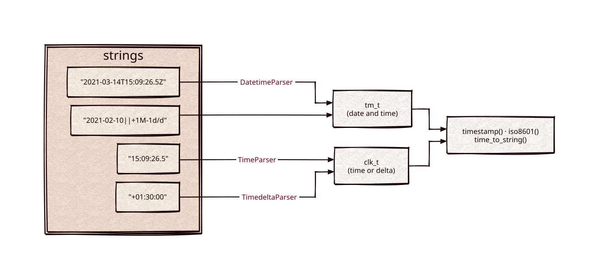

# datetime

Part of [Kronuz C++ Libraries](https://github.com/Kronuz/cpp-libraries), a collection of small, reusable C++ libraries.

[](https://github.com/Kronuz/datetime/actions/workflows/ci.yml)
[](LICENSE)


Date and time parsing for C++20: ISO 8601 timestamps, Elasticsearch-style date
math (`2021-01-01||+1M-1d/d`), times of day, and durations, with ISO 8601
formatting back out. For query languages and APIs that take dates as text.



## ✨ Highlights

- **ISO 8601**, date-only through fractional seconds, with `Z` or `±HH:MM`
  offsets.
- **Date math** after `||`: add and subtract `y M w d h m s`, round up to the end
  of a unit with `/M`, or down to its start with `//M`, leap years included.
- **Times and durations**: `"15:09:26.5"` and `"+01:30:00"`, to and from seconds.
- **Clear errors**: `DatetimeError` and its subclasses, all `std::runtime_error`.
- **Predicates**: `isDate`, `isDatetime`, `isTime`, `isTimedelta`.

## Behavior

- `Iso8601Parser(str, tm)` and `Iso8601Parser(str)` (and so `isDatetime` and
  `DatetimeParser`) agree on every input. A negative hour, minute or second
  (`T-3:04:05`) is `OUT_OF_RANGE`. A fraction dot with no digits (`...:05.`,
  `...:05.Z`) or with more than 62 digits is `ERROR`.
- An offset is applied and the result is the UTC instant, with `is_utc` set, in
  the ISO and the loose formats (`2020/01/02 03:04:05+05:30`). A loose-format
  string ending in `Z` is UTC too.
- Month arithmetic is exact for any count: `2020-12-15||+12M` is `2021-12-15`,
  and the day clamps to the length of the new month (`2020-01-31||+1M` is
  `2020-02-29`).
- The fraction of a timestamp is the distance above its whole second, before 1970
  as after: `timestamp` of 1969-12-31T23:59:58.9 is -1.1, and `to_tm_t(-2.9)` is
  1969-12-31T23:59:57.1.
- Date-math terms such as `+2147483647d` are computed in 64-bit arithmetic. The
  supported years are 1 to `INT_MAX`; a result beyond them throws
  `Year is out of range`. Year 1 with an offset that moves the instant before
  0001-01-01 throws the same error.

## 📦 Installation

Requires a C++20 compiler and CMake 3.14 or newer; it fetches
[strict-stox](https://github.com/Kronuz/strict-stox) and compiles one source file.
CI builds it on Linux (x86_64, arm64), macOS (arm64, x86_64), and FreeBSD, plus
ASan, UBSan, and TSan builds.

```cmake
include(FetchContent)
FetchContent_Declare(datetime
  GIT_REPOSITORY https://github.com/Kronuz/datetime.git
  GIT_TAG        main)
FetchContent_MakeAvailable(datetime)

target_link_libraries(my_app PRIVATE datetime::datetime)
```

## 🚀 Quick start

```cpp
#include "datetime.h"

#include <cstdio>

int main() {
	auto tm = Datetime::DatetimeParser(std::string_view("2021-03-14T15:09:26.5Z"));
	std::printf("%f\n", Datetime::timestamp(tm));                   // Unix seconds
	std::puts(Datetime::iso8601(tm).c_str());                       // 2021-03-14T15:09:26.5Z

	auto end_of_feb = Datetime::DatetimeParser(std::string_view("2020-02-10||/M"));   // 2020-02-29, end of day
	std::puts(Datetime::iso8601(end_of_feb).c_str());
}
```

[`examples/demo.cc`](examples/demo.cc) walks every input form and the rounding
rules.

## 🎯 When to use it

- ✅ Parsing dates from users or query strings, with relative date math.
- ❌ Time zones by name (`America/Mexico_City`) or calendars other than
  Gregorian: offsets only.
- ❌ "now": resolving relative-to-now expressions is the caller's job.

## 📚 Documentation

- [docs/API.md](docs/API.md): usage, every parser and formatter, and the scope.
- [ARCHITECTURE.md](ARCHITECTURE.md): the grammar and how date math is applied.
- [CHANGELOG.md](CHANGELOG.md): dated changes, behavior changes and benchmark history.
- [AGENTS.md](AGENTS.md): repository map and traps.

## 🛠️ Building and testing

```sh
cmake -B build && cmake --build build && ctest --test-dir build
./build/datetime_demo
```

## ⚡ Performance

Parsing and formatting avoid per-field library calls and allocations: fixed-width
digits are read directly, fractions up to 6 digits are integer microseconds, a
UTC offset is one integer add, the loose formats (`2020/01/02 3:04`) and
`|| date math` use hand scanners instead of `std::regex`, `iso8601` writes digits
into a stack buffer (fractions rounded exactly, ties to even, like `{:.6f}`), and
`to_tm_t` uses an integer civil-from-days conversion instead of `gmtime_r`.

`ctest` runs `datetime_diff_test`, a differential test of every entry point
against a frozen reference implementation in `test/old/`, and
`datetime_datemath_test`, which checks date math against independent references.
The input classes whose result differs from the reference are listed at the top
of `test/diff_test.cc` and in [CHANGELOG.md](CHANGELOG.md).

`datetime_bench` times each entry point against the reference on random inputs:

```sh
cmake -B build -DDATETIME_BUILD_BENCH=ON -DCMAKE_BUILD_TYPE=Release && cmake --build build
./build/datetime_bench
./build/datetime_compare
```

`datetime_compare` times the same entry points against independent implementations: a
hand-written ISO 8601 parser and formatter, the days-from-civil and civil-from-days
algorithms, libc `strptime` + `timegm`, and abseil's `ParseTime`, `FromCivil` and
`FormatTime` when abseil is installed. It checks that every comparator returns the same
results, and `ctest` runs that check. The hand-written parser reads one grammar and reports
failure with a bool; `datetime` also reads the loose forms, offsets and date math, validates
every field, and reports what was wrong. ns per call, one thread, 4096 random inputs, best of
two runs of seven passes:

| Operation | Apple M4 Pro | | Intel i9-9980HK | |
| :-- | --: | :-- | --: | :-- |
| parse `2020-01-02` | 10.4 | hand 5.9 | 26.3 | hand 15.1 |
| parse `2020-01-02T03:04:05Z` | 16.0 | hand 7.8, absl 100.8 | 40.2 | hand 22.7, absl 264.1 |
| parse `2020-01-02T03:04:05.123456Z` | 20.5 | hand 10.0, absl 133.1 | 48.6 | hand 28.2, absl 355.7 |
| parse `2020-01-02T03:04:05+05:30` | 28.8 | hand 8.9 | 62.7 | hand 26.7 |
| parse `2020/01/02 03:04:05` | 19.7 | hand 9.1, `strptime`+`timegm` 2192 | 56.3 | hand 24.4, `strptime`+`timegm` 7041 |
| `timestamp(tm_t)` | 2.8 | days-from-civil 1.8, absl 27.8 | 7.4 | days-from-civil 4.8, absl 71.5 |
| `to_tm_t(time_t)` | 8.9 | civil-from-days 6.1 | 24.1 | civil-from-days 14.3 |
| `iso8601(tm_t)` | 22.3 | hand 9.0, absl 1128 | 48.0 | hand 26.3, absl 2008 |
| `isDatetime` | 13.8 | hand 10.2 | 33.6 | hand 27.8 |

Apple clang 17 with `-O3` on both machines, abseil 20260817. `datetime` takes 1.2 to 3.2x the
hand-written parser's time and about a sixth of abseil's `ParseTime`. abseil's `FormatTime`
writes no fraction, so its row compares time only. The spread of a repeated run is under 3%
for most rows, up to 8% on the M4 Pro for two parse rows, and 30% for `iso8601` on the i9.

## 🤝 Contributing

Issues and pull requests are welcome. Read [AGENTS.md](AGENTS.md) first. CI must
pass on every platform.

## 📄 License

MIT, Copyright (c) 2015-2019 Dubalu LLC. See [LICENSE](LICENSE). Extracted from
[Xapiand](https://github.com/Kronuz/Xapiand).
